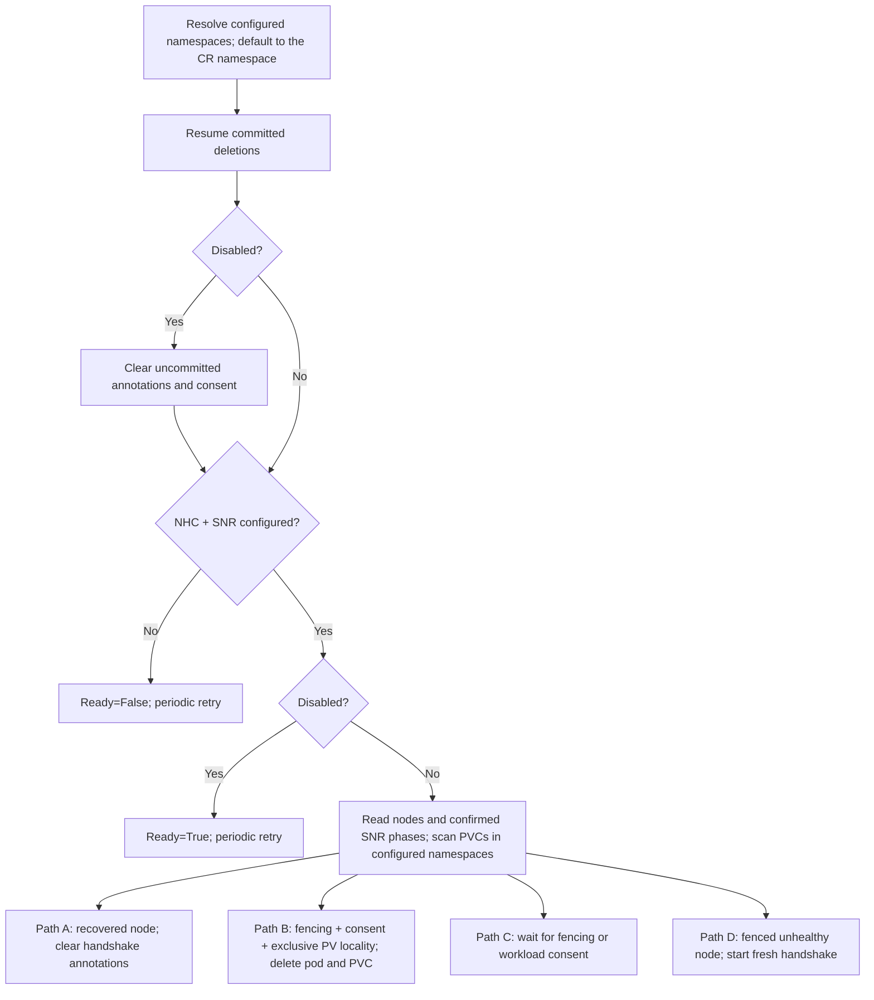
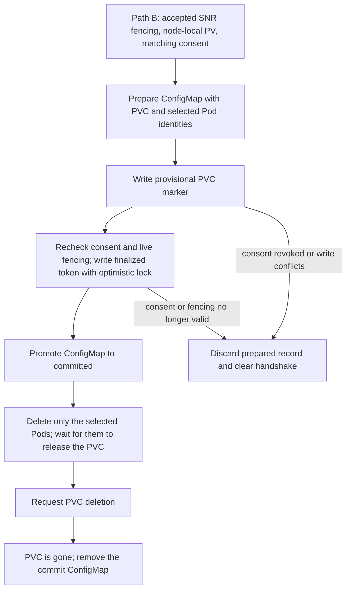

# PodRemediator – Architecture Reference

This document describes the PodRemediator API, controller flow, and workload-independent
behavior. Application-specific recovery policies are outside the controller's scope.

For operator/user documentation see [podremediator_guide.md](podremediator_guide.md).
For integration and test details, see the [Galera notes](podremediator_galera.md),
[RabbitMQ notes](podremediator_rabbitmq.md), and [testing guide](podremediator_testing.md).

## Design context

### Problem

Stateful workloads that use **local persistent storage** face a recurring issue
during node failures: the pod may be rescheduled but the PVC remains bound to the
dead node. Local storage cannot be reattached elsewhere; recovery requires manual
PVC deletion until a dedicated mechanism exists.

### Design principles

1. **Workload-owner authorization** — only the operator that owns the workload
   decides whether its recovery policy permits PVC deletion.
2. **Externalized action** — deletion is performed by a separate generic controller;
   application operators stay focused.
3. **Signal-based integration** — PodRemediator publishes a PVC request after SNR
   fencing confirmation; the workload operator grants request-scoped consent.
4. **NHC/SNR coordination** — a NotReady node alone does not authorize a PVC request.

### Workload-specific policy

PodRemediator does not decide whether an application's data is safe to discard.
The workload operator evaluates its own health and recovery policy and is the
only participant that grants or withholds consent. A PVC request is a signal to
evaluate, not an instruction to approve deletion.

### Workload integrations

Integration details can change independently of the generic controller. The
[Galera notes](podremediator_galera.md) describe the current Galera adapter; the
[RabbitMQ notes](podremediator_rabbitmq.md) describe the RabbitMQ integration
contract. Neither application's safety checks are requirements imposed on other
workload operators.

## API and Custom Resource

**API group**: `remediation.openstack.org/v1beta1`
**Kind**: `PodRemediator` (Namespaced)

**Source files**:
- `apis/remediation/v1beta1/podremediator_types.go`
- `apis/remediation/v1beta1/annotations.go`
- `config/crd/bases/remediation.openstack.org_podremediators.yaml` (`make manifests`)

### Spec

| Field | Type | Default | Description |
|-------|------|---------|-------------|
| `disabled` | `bool` | `false` | Stop annotation and deletion; clear pending consent. |
| `consentPollInterval` | `*metav1.Duration` | `"2m"` | Fallback requeue interval while waiting for fencing or consent. Overrides `PODREMEDIATOR_CONSENT_POLL_INTERVAL`. |
| `periodicPollInterval` | `*metav1.Duration` | `"5m"` | Safety-net requeue for idle states (catches restart-recovery case). Overrides `PODREMEDIATOR_PERIODIC_POLL_INTERVAL`. |

### Status Conditions

| Condition | Meaning |
|-----------|---------|
| `Ready=False` / `NHC/SNRNotFound` | NHC or SNR CRs not installed |
| `Ready=False` / `Error` | Scan error; will retry |
| `Ready=True` | Monitoring or active remediation |
| `InputReady=False` | NHC/SNR dependency not satisfied |

### PVC Annotations (shared contract)

Defined in `apis/remediation/v1beta1/annotations.go`. Application operators must
use these exact strings (import the package or copy with a cross-reference comment).

| Annotation | Set by | Value | Meaning |
|-----------|--------|-------|---------|
| `remediation.openstack.org/pvc-stuck-on-node` | PodRemediator | node name | Requests workload-operator evaluation; is not consent |
| `remediation.openstack.org/request-id` | PodRemediator | Non-empty opaque ID | Identifies the current fault-scoped request |
| `remediation.openstack.org/remediator-uid` | PodRemediator | PodRemediator UID | Binds the handshake to its owning CR |
| `remediation.openstack.org/fencing-node-uid` | PodRemediator | Node UID | Binds the handshake to the node incarnation |
| `remediation.openstack.org/safe-to-delete` | Application operator | `"true"` | Grants deletion consent |
| `remediation.openstack.org/consent-id` | Application operator | Exact `request-id` | Binds consent to the current request |

The application operator must apply its own safety policy, then patch
`safe-to-delete=true` and `consent-id` equal to the current `request-id` in one
optimistic-locking update. The IDs bind consent to the request being evaluated;
they do not prove that deletion is safe or identify who wrote the annotations.
Without the match, stale consent could authorize a later fault or race with a
changed request.

Consent may be withdrawn before the deletion commit. After the commit, cleanup
continues even if the consent annotations are removed. A newly observed,
unselected Pod can still abort cleanup before the PVC deletion request; after
Kubernetes accepts that request, it cannot be cancelled.

---

## Controller Internals

**Location**: `internal/controller/remediation/podremediator_controller.go`

### Reconcile Entry

1. Fetch the `PodRemediator` instance; return if not found.
2. Initialise status conditions; defer: restore timestamps, mirror Ready, patch status.
3. Add finalizer on first creation; requeue.
4. If `DeletionTimestamp` is set → `reconcileDelete`.
5. Otherwise → `reconcileNormal`.

### reconcileDelete

Resumes any previously committed PVC deletion, then clears uncommitted handshake
annotations from PVCs in the configured namespaces. The finalizer remains
until committed cleanup completes and annotation cleanup succeeds.

### reconcileNormal — Paths A/B/C/D



Each PodRemediator watches PVCs in the namespaces listed in `spec.namespaces`.
If the list is empty, it watches only its own namespace. PVC events in a watched
namespace enqueue the matching PodRemediator CR, including when the CR and PVC
are in different namespaces. The namespace scope is immutable after CR creation;
deleting the CR runs cleanup against its configured namespaces before a new CR
can be created with a different list.

When `disabled: true`, the controller still reconciles for two bounded purposes:
it resumes deletion commits that already exist and clears uncommitted annotations
and consent in the configured namespaces. This also cancels pending handshakes if NHC/SNR
become unavailable. Cleanup failures are retried. Re-enabling starts fresh
handshakes and requires new workload consent.

The controller lists Nodes and active (non-deleting) `SelfNodeRemediation`
objects. Only `status.phase: Reboot-Completed` or `Fencing-Completed` passes the
fencing gate. SNR performs the node-remediation action configured by the cluster;
PodRemediator does not issue a power-off or reboot request itself. It publishes
the PVC request annotation only after seeing one of those accepted phases. In the SNR
lifecycle, `Reboot-Completed` follows its safe reboot deadline and precedes
workload removal; `Fencing-Completed` follows that removal. These phases let
PodRemediator wait for SNR's declared safety barrier before publishing the PVC
request or deleting it. They do not move the local PV: its affinity can remain
pinned to the original node after a reboot, so workload recovery may still
require PVC cleanup. A missing phase, unknown phase, deleting SNR, or missing SNR
does not authorize deletion. Merely observing an elapsed `timeAssumedRebooted`
is insufficient. See the
[SNR controller](https://github.com/medik8s/self-node-remediation/blob/main/internal/controller/selfnoderemediation_controller.go).

Every reconcile scans existing handshakes, including when all remaining Nodes are
healthy. A missing Node does not imply recovery: a Node object can disappear
before its PVC has been cleaned up. The controller retains the request and
proceeds only when the current SNR evidence and the PV's pinning to the affected
node can still be established.

- **Path A — node recovered:** when the annotated node exists and is healthy,
  remove the handshake annotations so the next fault requires fresh consent.
- **Path B — consent granted:** require confirmed fencing, a non-empty current
  `request-id`, `safe-to-delete=true`, matching `consent-id`, and a bound local
  PV pinned to the annotated node. The controller records the consent before
  cleaning up the selected Pod UIDs and requesting PVC deletion. Existing
  handshakes can complete after the Node object disappears only while current
  SNR evidence and PV locality can still be established.
- **Path C — waiting:** retain the handshake while fencing or consent is missing.
  If an SNR expires or is removed while its node is still unhealthy, deletion
  pauses until fencing can be confirmed again. PVC annotation events trigger
  reconciliation, as do SNR phase changes.
- **Path D — new fault:** only annotate a local PVC after fencing is confirmed for
  its unhealthy node. Strip pre-existing consent in the same patch.

Annotation patches use optimistic concurrency so a concurrent consent change
cannot be silently overwritten. Scan or cleanup failures return an error;
otherwise PVCs waiting for fencing (including those not yet annotated) or consent
use `consentPollInterval`; idle scans use `periodicPollInterval`. Polling remains
a fallback if an SNR or PVC event is missed.

### Durable PVC deletion transaction

Path B prepares and commits PVC cleanup through a durable transaction. The
ConfigMap stores the PVC identity and the selected Pod names and UIDs; it is
controller-owned state, not a workload-operator input. PVC writers must not
have write access to these ConfigMaps.



Until the finalized token is written to the PVC, consent withdrawal or lost
fencing rejects the prepared record and cleanup does not start. The finalized
token write is the transaction's commit boundary: after it, reconciliation
resumes the recorded cleanup even if consent is removed, fencing evidence
changes, or the PodRemediator is disabled or deleted. If the process stops
between that write and ConfigMap promotion, the matching token lets the next
reconcile promote the prepared record and continue. After the selected Pods are
gone, the controller requests PVC deletion. Kubernetes accepting that delete
request is itself irreversible; if a replacement Pod then uses the terminating
PVC, the controller preserves the commit and waits for the workload operator to
release the Pod.

The implementation separates transaction state and validation in
`deletion_commit.go`, preparation and finalization in
`deletion_commit_prepare.go`, and restart recovery and cleanup in
`deletion_commit_resume.go`.

### Poll Interval Resolution

The controller is event-driven, but it also polls so a missed watch event or a
change in external state cannot leave a request waiting indefinitely. It resolves
two intervals independently for each PodRemediator CR. The consent interval
retries handshakes waiting for SNR fencing or workload-operator consent; the
periodic interval rechecks otherwise idle monitoring, including after an
operator restart when a Node was already unhealthy and no new Node transition
will arrive. The committed-deletion path uses a separate retry schedule based
on the two-minute default, shortened by `consentPollInterval` when it is also
waiting for fencing or consent, so cleanup continues after the commit boundary.

For `consentPollInterval` and `periodicPollInterval`, the per-CR spec field
takes precedence, followed by `PODREMEDIATOR_CONSENT_POLL_INTERVAL` or
`PODREMEDIATOR_PERIODIC_POLL_INTERVAL`, respectively, then the built-in
default. This lets one CR tune its retry behavior without changing other CRs;
the environment setting supplies a common value when the CR omits the field.
The defaults are two minutes for consent/fencing retries and five minutes for
idle polling. A resolved interval below one second is rejected to prevent a
tight requeue loop; CRD validation covers spec values, and the runtime check
also protects environment-provided values. These polls complement the event
watches described in [Watches](#watches).

```
effectiveInterval(spec.X, r.X, DefaultX):
  spec.X != nil  → use spec.X   (CR, per-instance, hot-reloadable)
  r.X > 0        → use r.X      (env var via main.go, operator-wide)
  otherwise      → use DefaultX (hardcoded: consent=2m, periodic=5m)
```

### Local PV Detection

**`isLocalPV(pv)`** accepts local, CSI, and HostPath volumes only when their
required node affinity exclusively identifies one node. Every OR selector term
must pin the same node using a known topology key with `operator: In` and exactly
one non-empty value. `NotIn`, multiple values, conflicting keys, and unpinned or
other-node alternatives are rejected. Additional AND constraints may narrow the
selection but cannot broaden it.

**`getLocalPVNodeName(pv)`** applies those checks using these known keys:

| Key | Driver |
|-----|--------|
| `kubernetes.io/hostname` | hostPath, local, many CSI |
| `topology.topolvm.io/node` | TopoLVM / Red Hat LVMS |
| `topology.lvms.io/node` | LVMS variant |

Zone-affinity volumes (Cinder: `topology.cinder.csi.openstack.org/zone`) are excluded.

Zone affinity identifies an availability zone, not one failed node. Such a PV
may be attachable on another node; deleting its PVC is therefore not the generic
recovery mechanism. CSI volumes are treated as local only when their affinity
proves an exclusive node pin.

If exclusive node pinning cannot be established, `getLocalPVNodeName` returns `""`
and remediation is skipped. Add supported keys to `localPVNodeTopologyKeys` when
integrating another local CSI driver.

### Watches

Each namespaced PodRemediator CR reconciles its own configuration. Its
`spec.namespaces` list selects the PVC namespaces it manages, defaulting to the
CR's namespace when empty. The controller also watches cluster-wide Node health
and SNR fencing state. On reconcile it reads the Nodes and active SNR instances
cluster-wide, then scans PVCs only in that CR's configured namespaces. These
scopes serve different purposes: a Node failure can affect a local PV in any
configured PVC namespace, so Node events and relevant SNR events enqueue every
PodRemediator CR. By contrast, a PVC event enqueues only CRs whose namespace
selection includes that PVC's namespace. This keeps unrelated PVC annotation
updates from reconciling every CR, while ensuring shared node and fencing
changes are seen wherever affected PVCs may live.

The watches filter noisy updates before they enqueue reconciles. Node additions
and deletions enqueue every CR; Node updates do so only when the Node crosses
between healthy and unhealthy as determined by its Ready condition. Kubelet
heartbeat updates that leave Ready health unchanged are ignored. PVC creation
and deletion, spec-generation changes, and annotation changes trigger the
namespace-aware mapping above. The SNR informer observes
`SelfNodeRemediation` instances across namespaces: additions and deletions
enqueue all CRs, while updates do so only when the phase, deletion timestamp,
or node-name label or annotation changes. Unrelated SNR status and metadata
updates are ignored. Periodic polling provides a fallback if a watch event is
missed.

NHC detects unhealthy Nodes and creates per-node SNR instances. SNR performs the
node-remediation action configured for the cluster and reports its progress;
PodRemediator does not reboot or fence Nodes itself. It observes these SNR
instances across namespaces and accepts only a non-deleting instance in
`Reboot-Completed` or `Fencing-Completed` as fencing evidence. It then proceeds
with its PVC handshake in the configured namespaces. A watch event or poll only
schedules a reconcile: every reconcile rechecks current Node/SNR state, PVC
locality, and workload consent before taking action. Each reconcile also checks
that at least one `NodeHealthCheck` and one `SelfNodeRemediationTemplate` exist;
these dependency checks are not watch sources.

---

## Current limitations

- PodRemediator authorizes PVC cleanup; it does not guarantee application
  recovery. Workload-specific rejoin, bootstrap, and data-recovery procedures
  remain the responsibility of the application operator.
- A new Pod that uses a PVC after deletion has been requested can keep that PVC
  in `Terminating`. PodRemediator waits and retains its finalizer; the workload
  operator must release the Pod safely. PodRemediator does not change workload
  replica counts or delete replacement Pods.
- The controller accepts only the documented SNR phases as its fencing gate.
  Missing, deleting, or unknown-phase SNR resources block new requests or pause
  cleanup that has not yet been committed.
- Local PV detection uses an explicit set of node-topology keys. A local storage
  driver with an unrecognized key is skipped until that key is supported.
- Status conditions and controller logs expose progress and errors, but status
  does not provide a structured per-PVC remediation list and the controller does
  not emit Kubernetes Events for each handshake step.

For test responsibilities and what each test layer validates, see the
[PodRemediator testing guide](podremediator_testing.md).
